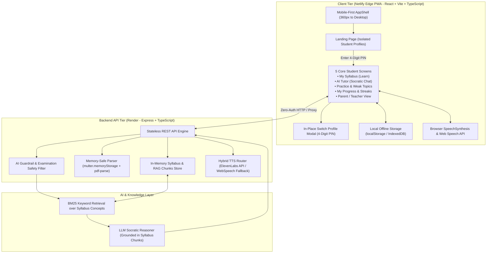
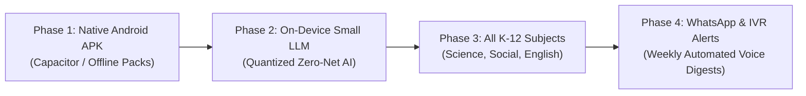

# Vidyapath — The Last-Mile Tutor (PS3)

[](https://github.com/yynvr1408/vidhyapath/actions)
[](LICENSE)
[](https://vidyapath1.netlify.app/)
[](https://vidhyapath-ote8.onrender.com)
[](https://www.typescriptlang.org/)
[](https://react.dev/)

> **An offline-resilient, zero-PII, trilingual (Telugu, Hindi, English) AI learning companion built for underprivileged Class 10 state-board students on shared family phones.**

---

## 🌐 Live Deployments & Quick Evaluation Links

| Environment / Service | Live URL | Credentials & Notes |
|:---|:---|:---|
| **Live Student PWA (Netlify)** | [https://vidyapath1.netlify.app/](https://vidyapath1.netlify.app/) | Zero-friction student profiles (PIN: `1234` or create new) |
| **Live Backend API (Render)** | [https://vidhyapath-ote8.onrender.com](https://vidhyapath-ote8.onrender.com) | Health probe: [`/healthz`](https://vidhyapath-ote8.onrender.com/healthz) • API: `/api/syllabus` |
| **Admin Syllabus-to-RAG Panel** | [https://vidyapath1.netlify.app/admin](https://vidyapath1.netlify.app/admin) | **Username:** `Admin` • **Password:** `admin123` |

### ⚡ 60-Second Hackathon Judge Quick-Start
1. Open the **[Live Student Web App](https://vidyapath1.netlify.app/)** on desktop or mobile.
2. Select any sample student profile (e.g. **👦 Ravi** or **👧 Priya**) and enter the 4-digit PIN: `1234` (or tap **`+ New Student`** to create a custom profile locally).
3. Switch languages seamlessly between **Telugu (తెలుగు)**, **Hindi (हिन्दी)**, and **English** using the top language selector.
4. Explore the **5 Core Student Pages**:
   - **My Syllabus (Learn):** Real Andhra Pradesh SSC Class 10 Maths chapters with worked steps.
   - **AI Tutor (Ask Doubt):** Chapter/concept guided Socratic chatbot, voice/photo inputs, audio pronunciation (🔊 Listen), and one-tap drill-down chips.
   - **Practice & Weak Topics:** Adaptive micro-quizzes with hint ladders and instant feedback.
   - **My Progress:** Mastery percentages and automated weak-topic revision buckets.
   - **Parent / Teacher View:** PIN-gated (`0000`) plain-language report with audio narration ("Listen to Report") and WhatsApp sharing.
5. Test the **[Admin Panel](https://vidyapath1.netlify.app/admin)** (`Admin` / `admin123`): Upload or paste any `.pdf`, `.txt`, or `.md` syllabus to observe live, in-memory RAG chunk ingestion and instant reflection in the AI Tutor.

---

## 🎯 Problem Statement 3 (PS3) Compliance Matrix

| PS3 Challenge & Core Requirement | Vidyapath Solution & Implementation | Codebase Module & Architecture |
|:---|:---|:---|
| **1. Regional Language End-to-End** | Full trilingual support in Telugu (`te`), Hindi (`hi`), and English (`en`) across all UI strings, syllabus cards, Socratic prompts, and hybrid speech engines. | `frontend/src/utils/translations.ts`, `backend/server/index.ts` |
| **2. Real State-Board Syllabus** | Pre-bundled with Andhra Pradesh State Board Class 10 Mathematics (`te-10-maths-ap.json`), plus dynamic multi-format syllabus ingestion via `/admin`. | `backend/public/packs/te-10-maths-ap.json`, `frontend/src/screens/MySyllabusScreen.tsx` |
| **3. AI Doubt Solving & Socratic Guidance** | Guided chapter → concept chips, 4-section structured explanations (Simple Meaning, Daily-Life Example, Step-by-Step, Quick Check), and one-tap follow-ups. | `frontend/src/screens/AiTutorScreen.tsx`, `backend/server/index.ts` (`POST /api/tutor/ask`) |
| **4. Shared-Phone & Offline Resilience** | Isolated multi-student profiles per family device protected by 4-digit PINs, offline quiz auto-save, and low-data modes without requiring email, phone, or passwords. | `frontend/src/context/AppContext.tsx`, `frontend/src/components/layout/AppShell.tsx` |
| **5. Low-Typing Accessibility** | Speech-to-Text microphone recording, Rear-Camera Photo/Diagram upload for textbook problems, and one-tap conversational follow-up chips. | `frontend/src/screens/AiTutorScreen.tsx` (Web Speech API & MediaDevices) |
| **6. Parent & Teacher Visibility** | Local code-gated (`0000`) guardian dashboard with plain-language vernacular summaries, "Listen to Report" audio narration, and one-click WhatsApp sharing. | `frontend/src/screens/ParentTeacherViewScreen.tsx`, `backend/server/index.ts` (`/api/tts`) |
| **7. Child Safety & Zero-PII Compliance** | 100% Zero-PII architecture. Zero student personal data (no phone numbers, email addresses, birthdays, or passwords) ever transmitted or stored. | `frontend/src/screens/LandingScreen.tsx`, `backend/server/services/aiGuardrails.ts` |

---

## 🏗️ System Architecture

### End-to-End Flow Diagram



### Architectural Highlights

1. **Client Tier (Netlify PWA):**
   - Built with **React 18**, **Vite 6**, and **Tailwind CSS**, optimized for budget Android devices with small viewports (`360px`) up to desktop displays.
   - Operates with an **offline-first local state engine** (`localStorage` & `IndexedDB`) allowing students to continue revision and quiz practice even when network connectivity drops.
   - Implements **in-place profile switching**: siblings sharing a household smartphone can switch between their accounts right inside the app via a responsive PIN modal without page redirects.

2. **Backend API Tier (Render):**
   - Pure stateless Express API providing `/api/tutor/ask`, `/api/tts`, `/api/syllabus`, and `/api/admin/syllabus`.
   - Employs **in-memory file handling** (`multer.memoryStorage()`) and text extraction (`pdf-parse`) ensuring zero disk writes, making the deployment fully compatible with ephemeral cloud containers (Docker/Render/K8s).

3. **Curriculum-to-RAG Pipeline (`/admin`):**
   - Teachers, government officials, or NGO staff can log into `http://localhost:3000/admin` (or Netlify `/admin`) using `Admin` / `admin123`.
   - Uploading a state-board textbook chapter (`.pdf`, `.txt`, `.md`) or pasting curriculum text automatically parses units into structured concepts, generates keyword-indexed RAG chunks, and updates the AI Tutor in real time without downtime or code deployments.

4. **Speech & Audio Layer:**
   - **Voice Input:** Web Speech API captures regional vernacular speech on modern browsers.
   - **Voice Output:** Hybrid Text-to-Speech router queries cloud high-fidelity neural audio for Telugu and Hindi, with seamless local browser `window.speechSynthesis` fallback when offline or unconfigured.

---

## 💼 Business Model, Sustainability & Scalability

### 1. Who Pays? (100% Free for Students)
Underprivileged government school students and their families never pay a rupee. Sustainability and operational costs are covered via structured institutional channels:
- **B2G (Business-to-Government):** Deployments funded through State Education Departments (e.g. Samagra Shiksha, AP/Telangana SCERT, Social Welfare Residential Schools) at district and state levels.
- **CSR Grants & NGO Sponsorships:** Corporate CSR foundations (mandated 2% corporate social responsibility in India) and education non-profits sponsor per-school cohorts and device distributions.

### 2. Technical & Operational Scalability
- **Zero-Code Multi-State Curriculum Ingestion:** Instead of building custom modules for every state board, education administrators simply upload their official state syllabus via `/admin`. The RAG chunking engine extracts chapters and concepts dynamically.
- **Ultra-Low Cloud Unit Economics:**
  - PWA static assets are served from Netlify's global edge CDN (free/near-zero bandwidth costs).
  - Stateless API deployed on containerized serverless infrastructure.
  - In-memory local RAG retrieval and concise, structured Socratic prompts minimize LLM token consumption to fractions of a cent per inquiry.
- **Device Independence:** Runs on any web browser (Chrome, Edge, Samsung Internet, Firefox) on shared Android family smartphones, eliminating the need for expensive native app distributions or dedicated student hardware.

### 3. Measurable Social Impact
- **Closing the Private Tuition Divide:** Over 70% of rural Class 10 students fail state exams due to lack of after-school tutoring. Vidyapath delivers 24/7 on-demand vernacular tutoring for free.
- **Empowering Semi-Literate Parents:** Rural parents who cannot read English or complex mathematical notation can tap **"Listen to Report"** to hear clear audio summaries of their child's daily learning progress and weak topics in Telugu or Hindi.

---

## 🚀 Future Scope & Native Mobile App Roadmap



- **Phase 1 — Native Android Mobile App (APK):**
  - Wrap the mobile-first PWA into a lightweight, standalone Android APK using Capacitor / React Native.
  - Enable one-tap download of entire semester syllabus packs for 100% offline access in remote rural areas with zero mobile data.
- **Phase 2 — On-Device Small Language Models (SLMs):**
  - Integrate quantized edge models (e.g. MobileLLM / Gemma 2B via WebGPU / ONNX Runtime) to provide conversational Socratic explanations directly on the phone with zero cloud roundtrips.
- **Phase 3 — Multi-State & Multi-Subject Expansion:**
  - Expand beyond Class 10 Mathematics to Physics, Chemistry, Biology, and Social Studies across AP, Telangana, Maharashtra, Karnataka, and CBSE boards, adding Kannada, Tamil, and Marathi.
- **Phase 4 — WhatsApp Digests & Automated IVR Voice Calls:**
  - Send weekly WhatsApp summary cards and automated 30-second regional voice calls to parents who do not use smartphones, keeping guardians engaged in their child's academic journey.

---

## 🛠️ Tech Stack

- **Frontend:** React 18, Vite 6, TypeScript 5.7, Tailwind CSS 3.4, Lucide Icons, Canvas Confetti.
- **Backend:** Node.js 22, Express 4.21, TypeScript, Multer (Memory Storage), PDF-Parse.
- **AI & Speech:** Socratic RAG Pipeline, OpenAI / Claude-compatible API, ElevenLabs Neural TTS API + Web Speech API.
- **Testing & Verification:** Tsx, Native Node Test Assertions, Health / Readiness Probes.
- **Deployment:** Netlify (Frontend PWA), Render (Stateless Backend Container).

---

## 💻 Local Development Setup

### Prerequisites
- **Node.js:** v20.x or v22.x
- **npm:** v10.x+

### 1. Clone & Install Dependencies
```bash
git clone https://github.com/yynvr1408/vidhyapath.git
cd vidhyapath
npm install
```

### 2. Configure Environment Variables
Copy `.env.example` to `.env` in the project root:
```bash
cp .env.example .env
```

Key environment variables:
```ini
PORT=3001
VITE_API_URL=http://localhost:3001

# Optional AI Tutor LLM (Falls back to robust rule-based syllabus engine if unset)
OPENAI_API_KEY=your_openai_or_compatible_api_key
TUTOR_MODEL=gpt-4o-mini
TUTOR_API_BASE_URL=https://api.openai.com/v1

# Optional ElevenLabs Neural Voice (Falls back to Web Speech API if unset)
ELEVENLABS_API_KEY=your_elevenlabs_key
```

### 3. Run Development Servers
In two separate terminals:

```bash
# Terminal 1: Start Express API server (Port 3001)
npm run server

# Terminal 2: Start Vite Frontend (Port 3000)
npm run dev
```

Open your browser at **`http://localhost:3000/`**.

### 4. Build & Verify
```bash
# Verify system verification and API suite
npm test

# Verify production build (TypeScript + Vite bundling)
npm run build
```

---

## 📄 License
This project is open-source and licensed under the [MIT License](LICENSE).
